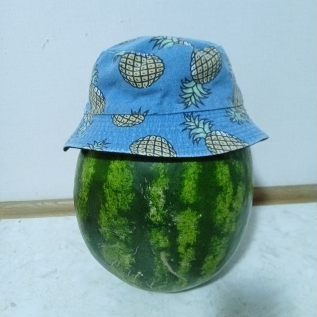

# README for KaG9S 

Hello! My nickname is KaG9S, but you cam call me jral, kages, george, and so on.
Here's some info about me.

## My works (on github or not)

- [nmbrz](https://github.com/KaG9S/nmbrz) - more accurate calculations for python. also breaking python limits
~~- [nmbrz-gui](https://github.com/KaG9S/nmbrz-gui) - calculator with nmbrz as base~~
~~- [OpenspaceOS](https://github.com/OpenspaceOS) - **future** OS (based on linux) for servers, codebases, and virtual machines.~~
~~- [UPM](https://github.com/OpenspaceOS/upm) - cool package manager, and main one for OpenspaceOS. Breaking every philosophy~~
- [psich_bot](https://github.com/KaG9S/psich_bot) - template project for telegram bot. [README](https://github.com/KaG9S/psich_bot/blob/main/README.md) for more
- [Last floor](https://t.me/lastfloor_offical) - **future** indie game on roblox

## Contact

> \[!NOTE]
> At most, my nickname in socials is also KaG9S, but there are excludes. They've listed below as well

- [Telegram](https://t.me/KaG9S) and [tg bio](https://t.me/sudo_opsec)
- gmail - jokageorgik@gmail.com and kkntevest@gmail.com
- Discord - KaG9S
- [TikTok](https://www.tiktok.com/@kag9s)

## Communities i am related to

- [OpenspaceOS project](https://github.com/OpenspaceOS)
- [Aksol team](https://www.tiktok.com/@aksolteam)
- [LastFloor](https://t.me/LastFloor_Official)

### Langs that i learn
- Python/Lua
- HTML/CSS/JS
- C/C++ (Low)

### My main OS
- [Tiny10](https://archive.org/details/tiny-10-23-h2) (iMac 8.1 A1224)
- Windows10 (Acer E5-576 and HP Probook 6360b)
- [Rasberry Pi Os](https://www.raspberrypi.com/software/operating-systems/) Lite (Linux dist.) (PaspberryPi 3B+)
- Android ([OneUI](https://www.samsung.com/uk/one-ui/)) (Samsung Galaxy A15)

---
# end
Contact me if you want!
>.<
